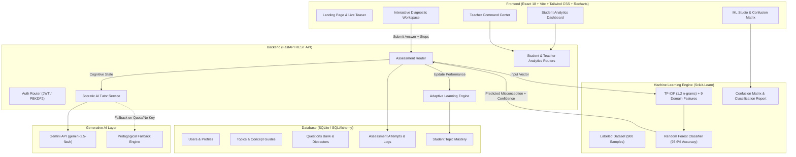

# thinkSync AI
> **"Don't Just Know You're Wrong. Understand Why."**

[-success?style=for-the-badge&logo=cloudflare)](https://topics-suffered-earrings-redhead.trycloudflare.com)
[](https://fastapi.tiangolo.com)
[](https://react.dev/)
[-F7931E.svg?logo=scikit-learn&logoColor=white)](https://scikit-learn.org/)
[](https://ai.google.dev/)
[](https://tailwindcss.com/)

🌐 **Live Deployment Link:** [https://topics-suffered-earrings-redhead.trycloudflare.com](https://topics-suffered-earrings-redhead.trycloudflare.com)

---

## 1. Executive Summary & Vision

Traditional educational platforms evaluate student submissions through a **binary lens**: answers are either correct or incorrect. When students get a question wrong, they are simply marked down or shown the final answer, leaving the fundamental question unanswered: **Why did the student make that mistake?**

**thinkSync AI** is a full-stack, intelligent educational platform engineered for college-level AIML capstone demonstration. Rather than simply evaluating final numbers, thinkSync AI:
1. **Analyzes intermediate solving steps** and student problem-solving approaches.
2. **Classifies cognitive misconceptions** using a genuine, reproducible **Scikit-learn Machine Learning classifier** (achieving **95.56% accuracy** and **0.958 Macro F1** across 7 classes).
3. **Engages a personal Socratic AI Tutor** powered by the **Gemini API** (with a high-fidelity pedagogical fallback engine) that explains the root misunderstanding without immediately spoiling the solution.
4. **Maintains an Adaptive Learning Engine** that tracks recurring cognitive bottlenecks, adjusts difficulty, and deploys foundational concept interventions when repeated mistakes occur.
5. **Provides Dual Interfaces**:
   - **Student Dashboard**: Mastery radial cards, misconception distribution radar, cumulative accuracy learning trajectory, and interactive step-by-step diagnostic workspace.
   - **Teacher / Administrator Dashboard**: Classroom-wide error distribution, concept difficulty ranking, real-time submission stream, and student roster with proactive intervention flags.

---

## 2. Core Misconception Taxonomy

The system is trained to identify and categorize student mistakes into well-defined cognitive patterns:

| Misconception Category | Description | Example Error Pattern |
|---|---|---|
| **Inverse Operation Error** | Student performs the opposite operation (adding instead of subtracting across $=$, or multiplying instead of dividing). | $2x + 7 = 19 \implies 2x = 19 + 7 = 26 \implies x = 13$ |
| **Sign / Integer Error** | Dropping negative signs, negative multiplication mistakes, or failing to distribute negatives across parentheses. | $-3x = 12 \implies x = 4$, or $-(2x - 5) \implies -2x - 5$ |
| **Arithmetic Calculation Slip** | Conceptual logic and algebraic isolation steps are sound, but an arithmetic slip occurs in mental math. | $3x = 32 - 14 \implies 3x = 17$ (instead of 18) |
| **Multiplication / Division Inversion** | Inverting numerator and denominator, or dividing straight across instead of multiplying by the reciprocal. | $6x = 3 \implies x = 6 / 3 = 2$ (instead of $3/6 = 0.5$) |
| **Conceptual Misunderstanding** | Violating fundamental rules such as combining unlike terms, order of operations (PEMDAS), or treating percentages as flat subtractions. | $3x + 5 = 8x$, or "20% of 80" $\implies 80 - 20 = 60$ |
| **Fraction Operation Error** | Direct addition or subtraction of denominators across fractions without finding a common denominator (LCD). | $\frac{1}{3} + \frac{1}{4} = \frac{2}{7}$ |
| **Uncertain / Insufficient Evidence** | Student provides incomplete, ambiguous, or empty steps where evidence is insufficient to diagnose a specific misconception. | Single-word answers without intermediate calculation |

---

## 3. System Architecture



---

## 4. Machine Learning Pipeline Details

The ML component is **not** a mock or an LLM prompt. It is a genuine, independently trained Scikit-learn pipeline:

1. **Dataset Generation (`backend/ml/dataset_generator.py`)**:
   - Generates 900 balanced, realistic student attempts with natural-language step formatting, typos, varying numerical scales, and distractors across all 4 math domains.
   - Seeded (`seed=42`) for 100% reproducibility.
2. **Feature Engineering**:
   - **Text Representation**: `TfidfVectorizer` (unigrams and bigrams, sublinear term frequency scaling, max 2500 features) on composite strings combining Question context, Student answer, Intermediate steps, and Selected approach.
   - **Domain & Behavioral Features**: `step_count`, `has_negative`, `has_fraction`, `has_multiply`, `has_equal`, `has_percent`, `len_answer`, `len_steps`, `exact_match`.
3. **Model Selection & Evaluation (`backend/ml/train_model.py`)**:
   - Evaluates **Logistic Regression** vs. **Random Forest Classifier** via 5-Fold Stratified Cross-Validation.
   - Random Forest achieved the winning score:
     - **Test Set Accuracy**: `95.56%`
     - **Macro Precision**: `0.9602`
     - **Macro Recall**: `0.9575`
     - **Macro F1-Score**: `0.9579`
   - Exports serialized model to `backend/ml/model.joblib` and metrics to `backend/ml/metrics.json`.
4. **Uncertainty & Rejection Gate**:
   - If classifier confidence is below $0.35$ or if input lacks diagnostic signal, the system returns `uncertain_insufficient_evidence` rather than hallucinating a false diagnosis.

---

## 5. Instant 1-Click Demo Accounts

For college exhibition presentations, judges and reviewers can sign in with 1 click using the built-in demo switcher:

| Persona | Username | Password | Purpose |
|---|---|---|---|
| **Student** | `alex_student` | `student123` | Demonstrates personalized dashboard, misconception tracking radar, interactive quiz workspace, and Socratic hints. |
| **Teacher** | `sarah_teacher` | `teacher123` | Demonstrates classroom error distribution, concept difficulty ranking, student roster, and proactive intervention alerts. |

---

## 6. How to Run the Platform

### Prerequisites
- Python 3.10+ (tested on Python 3.14)
- Node.js 18+ and npm

### Step 1: Clone & Navigate to Project
```bash
cd c:\Users\Siddharth\OneDrive\Desktop\thinksync
```

### Step 2: Start the FastAPI Backend
```bash
# In your terminal:
python backend/app/main.py
```
*The backend automatically initializes SQLite tables and seeds topics, questions, demo accounts, and historical attempt analytics on startup at `http://127.0.0.1:8000`.*
*Interactive API Swagger documentation is available at `http://127.0.0.1:8000/docs`.*

### Step 3: Start the React Frontend
```bash
# In a second terminal:
cd frontend
npm run dev
```
*Vite will launch the frontend at `http://localhost:5173`.*

### (Optional) Gemini API Key Configuration
To connect live Gemini API tutoring, set the environment variable:
```bash
export GEMINI_API_KEY="your-gemini-api-key"   # Linux/macOS
$env:GEMINI_API_KEY="your-gemini-api-key"      # Windows PowerShell
```
*If not set, thinkSync AI automatically runs in standalone mode using its built-in expert pedagogical engine.*

---

## 7. Project Structure

```
thinksync/
├── backend/
│   ├── app/
│   │   ├── __init__.py
│   │   ├── main.py                     # FastAPI entrypoint, CORS, startup seeding
│   │   ├── config.py                   # App settings & environment variables
│   │   ├── database.py                 # SQLAlchemy SQLite engine & session
│   │   ├── models.py                   # Users, Topics, Questions, Attempts, Masteries
│   │   ├── schemas.py                  # Pydantic request & response models
│   │   ├── auth.py                     # RFC 7519 HMAC-SHA256 JWT & PBKDF2 hashing
│   │   ├── seed_data.py                # Database population (4 topics, 14 questions, users)
│   │   ├── routers/
│   │   │   ├── auth_router.py          # /api/auth (register, login, me)
│   │   │   ├── topics_router.py        # /api/topics (topics & questions)
│   │   │   ├── assessment_router.py    # /api/assessment (evaluate & hint)
│   │   │   ├── student_router.py       # /api/student (analytics & timeline)
│   │   │   ├── teacher_router.py       # /api/teacher (class aggregates & interventions)
│   │   │   └── ml_router.py            # /api/ml (predict & metrics)
│   │   └── services/
│   │       ├── tutor_service.py        # Gemini Socratic Tutor & Fallback Pedagogy
│   │       └── adaptive_engine.py      # Bayesian Mastery & Bottleneck Detection
│   ├── ml/
│   │   ├── dataset_generator.py        # Reproducible 900-sample dataset generator
│   │   ├── train_model.py              # ML training, cross-validation, and metrics export
│   │   ├── predictor.py                # Real-time inference & uncertainty detection
│   │   ├── dataset.csv                 # Labeled training dataset
│   │   ├── model.joblib                # Serialized Scikit-learn pipeline
│   │   └── metrics.json                # Evaluated confusion matrix & per-class F1
│   ├── requirements.txt
│   └── .env.example
├── frontend/
│   ├── index.html
│   ├── package.json
│   ├── vite.config.js
│   ├── tailwind.config.js
│   ├── postcss.config.js
│   └── src/
│       ├── main.jsx
│       ├── App.jsx                     # Route architecture
│       ├── index.css                   # Custom typography & styles
│       ├── api/
│       │   └── client.js               # REST client with auth injection
│       ├── context/
│       │   └── AuthContext.jsx         # Global user session & 1-click persona switcher
│       ├── components/
│       │   ├── Navbar.jsx              # Responsive navigation & demo controls
│       │   ├── Footer.jsx              # Project specs footer
│       │   ├── MetricCard.jsx          # Reusable analytics cards
│       │   └── MisconceptionBadge.jsx  # Color-coded badges with confidence & tooltips
│       └── pages/
│           ├── HomePage.jsx            # Landing page with live ML demo teaser
│           ├── LoginPage.jsx           # Sign in with 1-click demo buttons
│           ├── RegisterPage.jsx        # Account registration
│           ├── StudentDashboard.jsx    # Progress, radar chart, trajectory, recent logs
│           ├── TopicAssessmentPage.jsx # Interactive quiz, step editor, Socratic tutor
│           ├── TeacherDashboard.jsx    # Class error distribution, difficulty index, roster
│           ├── MLPlaygroundPage.jsx    # Confusion matrix, metrics, live inference sandbox
│           └── ConceptsPage.jsx        # Mathematical theory & trap explanations
├── test_direct.py                      # Direct end-to-end verification test suite
└── README.md
```
